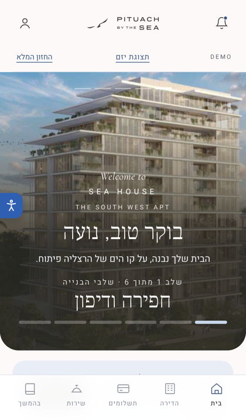
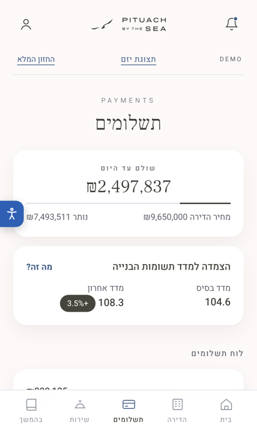
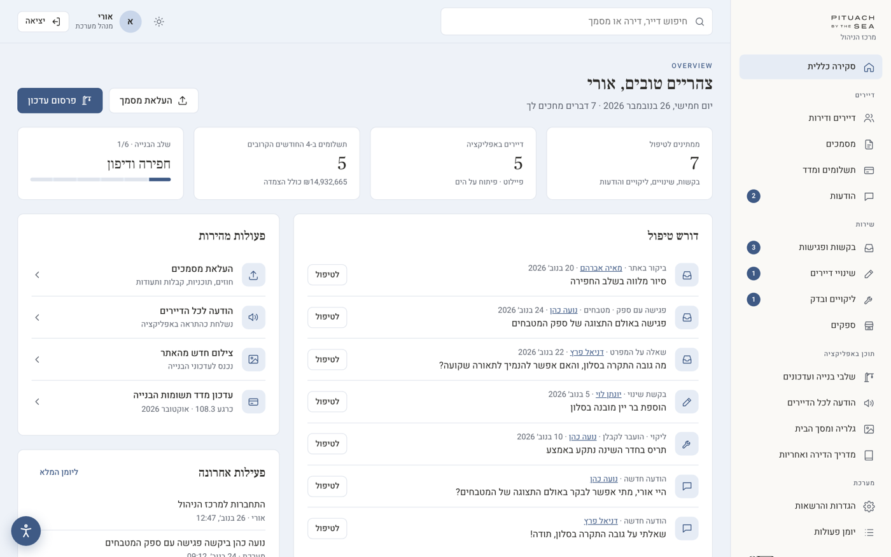
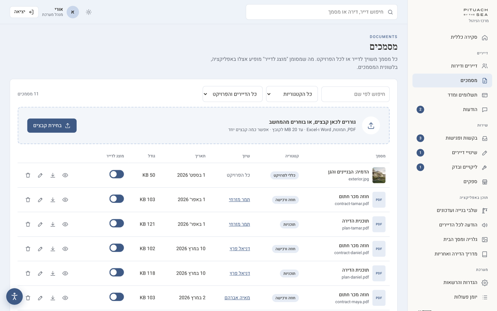

<div dir="rtl" align="right">

# Pituach by the Sea · אפליקציית הדיירים

אב טיפוס של אפליקציית הדיירים של **פיתוח על הים, הרצליה פיתוח**, ושל מרכז הניהול שמפעיל אותה. כל הנתונים באתר הם לדוגמה.

### לצפייה

| | קישור | איפה לפתוח |
|---|---|---|
| דף הפתיחה | https://uribaumann.github.io/pituach-demo/ | |
| אפליקציית הדיירים | https://uribaumann.github.io/pituach-demo/app/ | בטלפון. אפשר להתקין למסך הבית |
| מרכז הניהול | https://uribaumann.github.io/pituach-demo/admin/ | במחשב |

## אפליקציית הדיירים

<p align="center">



</p>

- מסך בית אישי לכל דייר, עם תמונות הפרויקט שמתחלפות
- שלבי הבנייה וצילומים מהאתר
- לוח תשלומים והצמדה למדד
- חוזה ותוכנית הדירה לצפייה והורדה
- בקשות: פגישה עם ספק, ביקור באתר ושאלות על המפרט
- עברית ואנגלית, ותפריט נגישות

<p align="center"></p>

**התקנה בטלפון:** סורקים את הקוד. באייפון פותחים את הקישור ב-Safari, לוחצים על כפתור השיתוף ובוחרים "הוסף למסך הבית". באנדרואיד פותחים ב-Chrome ולוחצים "התקנה".

## מרכז הניהול

<p align="center"></p>
<p align="center"></p>

- דיירים ודירות, עם כל השדות שמופיעים באפליקציה
- העלאת מסמכים בגרירה, ושיוך לדייר או לכל הפרויקט
- תשלומים ועדכון מדד
- בקשות ופגישות עם ספקים, שינויי דיירים וליקויים
- שלבי בנייה, עדכונים לדיירים והודעות, עם אישור סמנכ״ל מגורים לעדכון שמזכיר מועד
- גלריה ובחירת התמונות למסך הבית
- כניסה בדוא״ל וסיסמה. כרגע רק למנהל המערכת

## לתשומת לב

זה דמו להצגה פנימית. הכניסה למרכז הניהול נבדקת בדפדפן בלבד, וקבצים שמעלים נשמרים רק בדפדפן שהעלה אותם. לא מעלים לכאן מסמכים אמיתיים של דיירים.

## עדכון האתר

הקוד נמצא בתיקייה `source/`. אחרי שינוי מריצים:

```bash
./publish.sh "מה השתנה"
```

הסקריפט בונה את שני החלקים, שומר ומעלה. GitHub Pages מעדכן את האתר בתוך כדקה.

</div>
